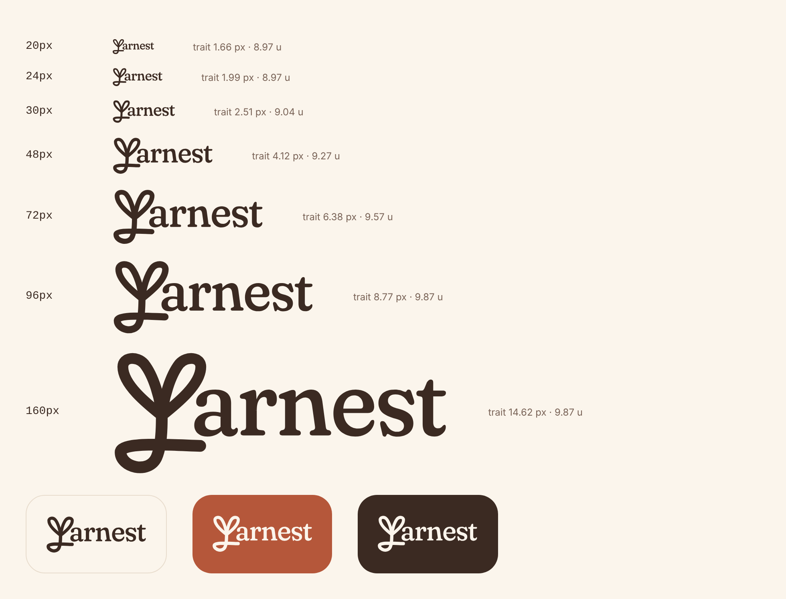

# Logo Yarnest — règles d'usage et intégration front

Source : maquette Figma « Logo » (UI Kit v1). Composant : `Wordmark` (`src/ui/Logo.tsx`).

## 1. Anatomie

- **Symbole** : une pousse tracée d'un seul fil (tige bouclée, deux feuilles). Il fait office de « Y ».
- **Mot** : « arnest », serif à fûts pleins et déliés, dessiné en tracés (pas une police chargée).
- Les deux forment un bloc indissociable : on n'écrit jamais « Yarnest » en texte vivant à la place du logo, et on ne rapproche ni n'écarte le symbole du mot.

Mesures de référence (unités du logo, hauteur 108) :

| Élément                         | Valeur                          |
| ------------------------------- | ------------------------------- |
| Fût des lettres (`n`, `r`, `t`) | 8,97 u                          |
| Hauteur d'x (« a », « n »)      | ≈ 39 u, soit 36 % de la hauteur |
| Proportions du bloc             | 284 × 108 (≈ 2,63 : 1)          |

## 2. Trait du symbole : il suit la taille

Le symbole est d'épaisseur égale ; le mot a des contrastes. Pour qu'ils pèsent pareil à toutes les tailles, le trait du symbole est calculé depuis la hauteur affichée (`logoStroke`, testé) :

| Hauteur affichée | Trait de la tige                    | Raison                                                               |
| ---------------- | ----------------------------------- | -------------------------------------------------------------------- |
| ≤ 24 px          | = fût des lettres (8,97 u)          | Les déliés s'effacent : un trait plus gras écraserait le mot.        |
| 24 → 96 px       | progression linéaire                | Le trait s'épaissit sans saut.                                       |
| ≥ 96 px          | fût × 1,1 (9,87 u, valeur maquette) | Les contrastes du mot se lisent : le symbole garde la même présence. |

Les feuilles valent 92 % de la tige (rapport de la maquette). En pixels, le trait grandit toujours avec le logo (1,7 px à 20 px, 8,8 px à 96 px).

**Intégration** : rien à faire, `Wordmark` mesure sa hauteur (`ResizeObserver`) et ajuste le trait. Ne jamais forcer `stroke-width` en CSS.

## 3. Taille

- **Pas de hauteur en pixels.** Par défaut, le logo fait une ligne du texte qui l'entoure (`height: 1lh`) : il suit le token typo de l'endroit et la taille de texte choisie dans le système.
- Pour le dimensionner, donner au conteneur ou à la classe passée un token typo (`font: var(--text-h2)` → 30 px de haut), jamais une hauteur codée en dur.
- **Taille minimale : 20 px de haut** (hauteur d'x ≈ 7 px). En dessous, les déliés de « arnest » disparaissent : utiliser l'icône d'app (symbole seul) ou le nom en texte.
- La largeur suit toujours (`width: auto`) : jamais de déformation.

## 4. Zone de protection

Autour du logo, un vide égal à la **hauteur d'x** (36 % de sa hauteur) : ni texte, ni bouton, ni bord d'écran dedans. À 30 px de haut, ≈ 11 px : la marge latérale `--space-4` suffit.

## 5. Couleurs

Le logo prend `color` (il est en `currentColor`). Deux versions seulement :

| Version            | Couleur   | Fonds autorisés                                                        | Contraste       |
| ------------------ | --------- | ---------------------------------------------------------------------- | --------------- |
| Encre (par défaut) | `--ink`   | `--paper`, `--surface`, halos (`--peach`, `--apricot`, `--sage-light`) | 5,6 à 13,6 : 1  |
| Crème              | `--paper` | `--primary`, `--ink`                                                   | 4,4 et 12,6 : 1 |

- Jamais terracotta : `--primary` est réservé à l'action principale de l'écran. Le symbole terracotta de la maquette n'a pas d'usage dans l'app.
- Sur un halo, encre uniquement (même règle que le texte).
- Jamais de dégradé, d'ombre, de contour, d'opacité réduite, ni sur la texture jersey.

## 6. Symbole seul

Réservé à l'**icône d'app** (`public/icon.svg`, carré terracotta rayon 22/96, symbole crème) et au favicon. `npm run icons` régénère les PNG de la PWA depuis ce fichier. Dans l'interface, on utilise le logo complet.

## 7. Accessibilité

- `Wordmark` est une image nommée : `role="img"` et `aria-label`, toujours `t('app.name')` (jamais de texte en dur).
- Le nom n'est annoncé qu'une fois : si « Yarnest » est déjà lu juste à côté, ne pas l'y répéter.

## 8. À ne pas faire

- Étirer, pivoter, recadrer, changer les proportions.
- Recomposer « arnest » avec Fraunces ou une autre police.
- Changer l'épaisseur du trait à la main, ou figer une hauteur en pixels.
- Placer le logo dans une zone tactile sans libellé, ou en faire le seul repère d'un bouton.
- L'utiliser sous 20 px de haut.

## Usages actuels

| Écran                | Version                      | Taille              |
| -------------------- | ---------------------------- | ------------------- |
| Onboarding, en-tête  | Encre sur halo               | `--text-h2` (30 px) |
| Icône d'app, favicon | Symbole crème sur terracotta | fichiers `public/`  |
